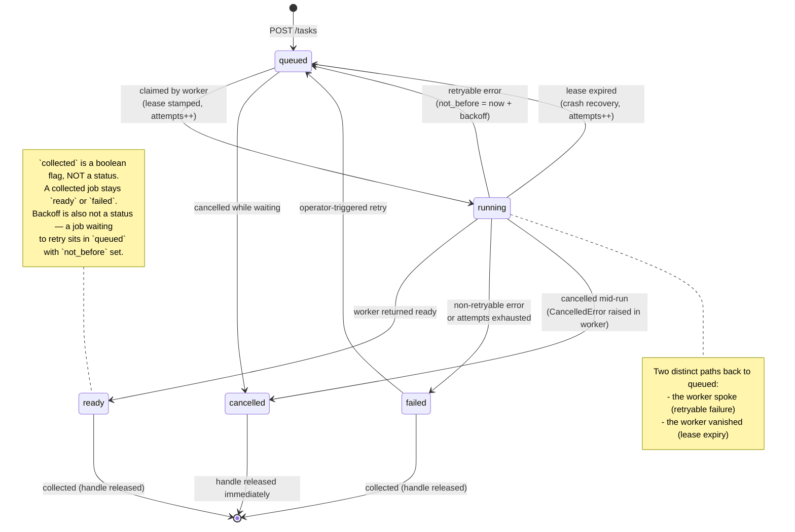
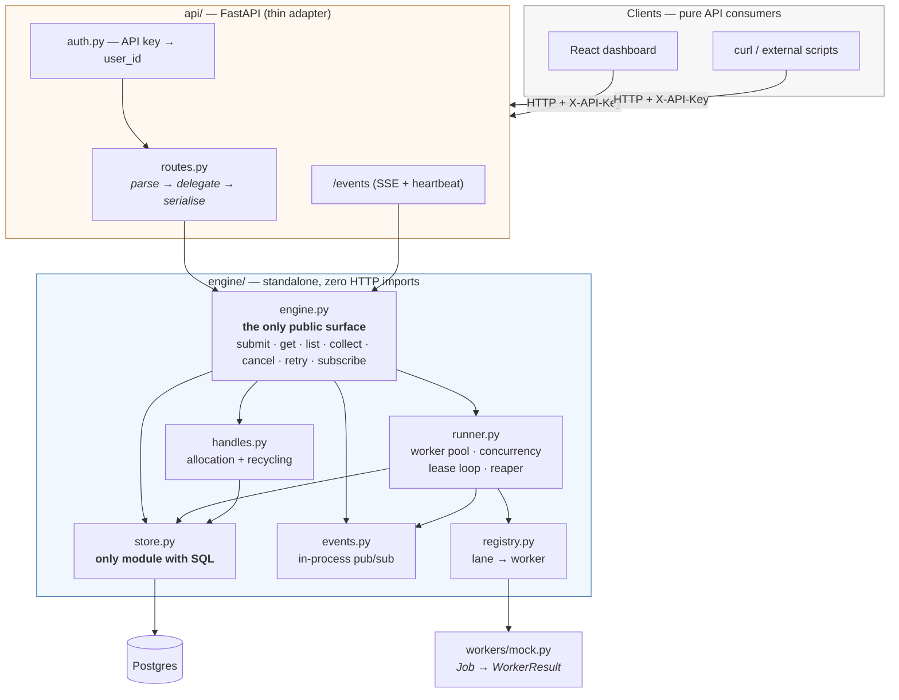
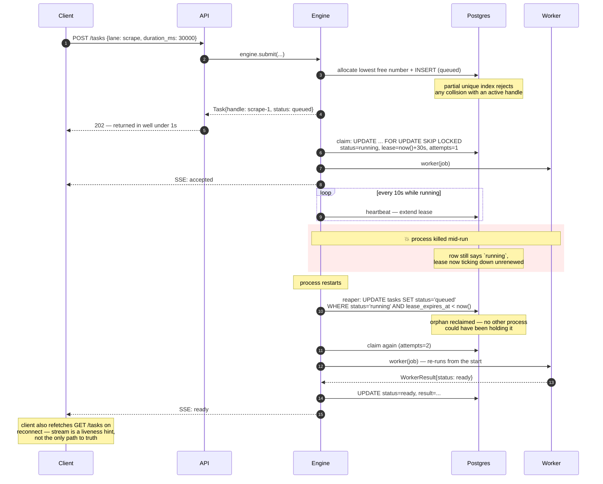

# Background Job Runner

## Overview

## Architecture

### 1. Job lifecycle

The five statuses are fixed by the API contract. Every transition below is one the engine actually performs.

### 2. Module boundaries

The two rules this diagram encodes: nothing under `engine/` imports a web framework, and nothing outside `store.py` touches the database.

**Verifiable in seconds:** `grep -r "fastapi" engine/` returns nothing. `grep -rl "asyncpg" engine/` returns exactly one file.

### 3. Durability — crash and recovery

This is the "sketch your approach" the brief asks for in the durability section.

The reaper runs on boot **and** on a timer — boot-only recovery would miss a worker that hung rather than died.

## Setup & Running Locally

### Known issues

**Docker Desktop + WSL2: pulls fail with truncated layers.** Docker Desktop's containerd image store mishandles range-requested downloads over WSL2, causing `httpReadSeeker: failed open ... EOF` mid-pull. Affects both Windows 10 and 11. Fix: in Docker Desktop, **Settings → General**, disable **"Use containerd for pulling and storing images"**, then Apply & Restart.

## API Reference

## Testing

## Deployment

## Decisions & Tradeoffs

See `DECISIONS.md` for the full log of forks resolved during the build, with options considered and why.

## Demo

## What I'd Do Next
