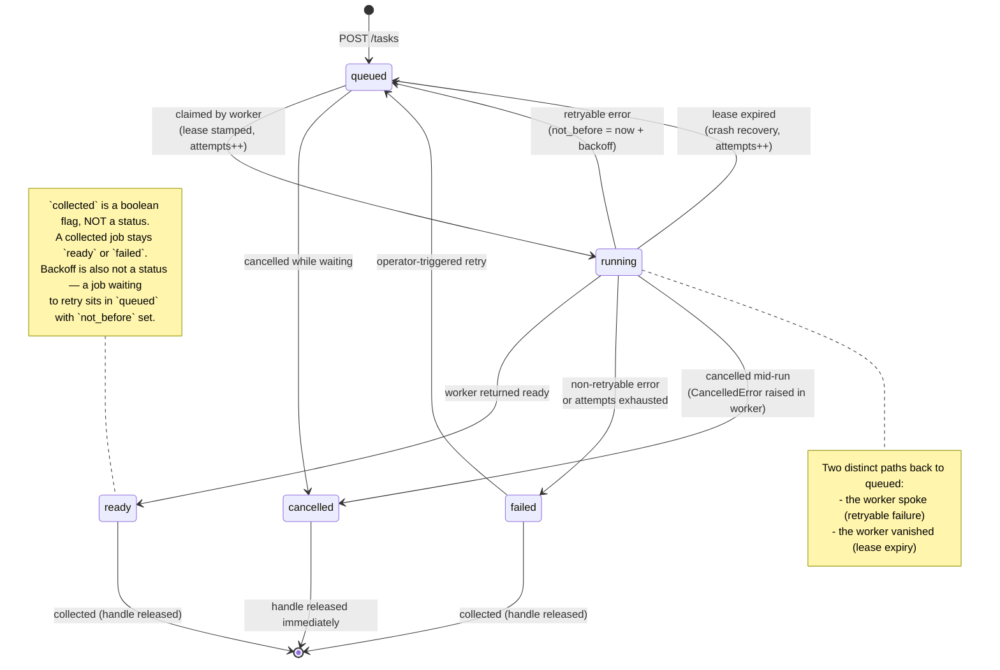
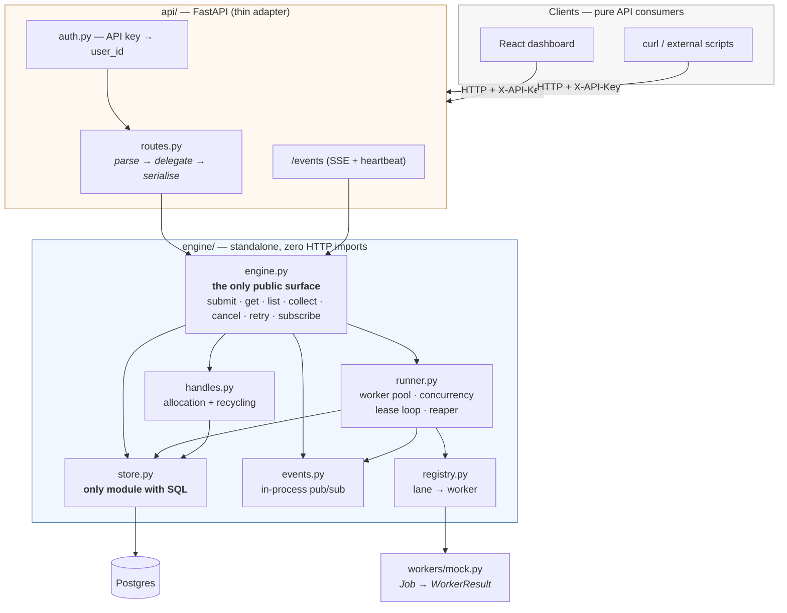
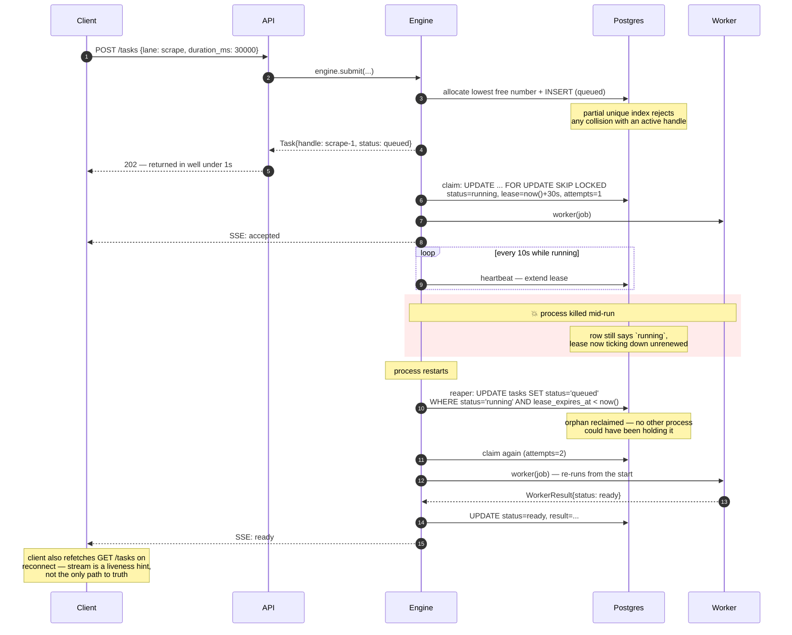

# Background Job Runner

## Overview

## Architecture

### 1. Job lifecycle

The five statuses are fixed by the API contract. Every transition below is one the engine actually performs.



### 2. Module boundaries

The two rules this diagram encodes: nothing under `engine/` imports a web framework, and nothing outside `store.py` touches the database.



**Verifiable in seconds:** `grep -r "fastapi" engine/` returns nothing. `grep -rl "asyncpg" engine/` returns exactly one file.

### 3. Durability — crash and recovery

This is the "sketch your approach" the brief asks for in the durability section.



The reaper runs on boot **and** on a timer — boot-only recovery would miss a worker that hung rather than died.

## Setup & Running Locally

### Database schema

`sql/schema.sql` is the single source of truth for the database, applied by
hand — there's no migration tooling and no `docker-entrypoint-initdb.d` init
script wired into `docker-compose.yml` (see DECISIONS.md, "Raw SQL via
asyncpg rather than an ORM": migrations were a deliberate non-goal for this
proof of concept). After `docker compose up -d`, apply it once:

```
docker compose exec postgres psql -U jobrunner -d jobrunner -f - < sql/schema.sql
```

**If you already have a running database from before `tasks.seq` was added**
(the monotonic ordering column — see DECISIONS.md, "Handle resolution
ordering uses a monotonic sequence, not a timestamp"), a fresh `schema.sql`
apply won't retroactively add it to an existing table. Run the one statement
by hand instead:

```
docker compose exec postgres psql -U jobrunner -d jobrunner -c "ALTER TABLE tasks ADD COLUMN seq BIGSERIAL;"
```

Same end state either way — a fresh clone gets `seq` from `schema.sql`
directly; an existing database gets there via this one `ALTER TABLE`. Worth
keeping in mind if `schema.sql` picks up further changes later: without
migration tooling, every existing database needs its own hand-applied catch-up
statement, not just new ones.

### Seed data

`scripts/seed.py` creates two named demo users and a realistic spread of
tasks across every status, so the dashboard's filtering, sorting, and detail
views have something meaningful to show without needing to manually drive
jobs through the API first. Run it once the schema is applied and the API's
dependencies are installed:

```
python -m scripts.seed
```

This creates:

- **Two users** — `Alice` (`X-API-Key: alice-demo-key`) and `Bob`
  (`X-API-Key: bob-demo-key`). A bare run never touches any other user —
  it only ever creates/updates these two and inserts their tasks.
- **~28 tasks for Alice, ~7 for Bob** — every status represented
  (`queued`, `running`, `ready`, `failed`, `cancelled`), both lanes
  (`scrape`, `report`), a mix of collected/uncollected terminal tasks, and
  `created_at` spread across the last two weeks so date-range filtering has
  something to filter. Every failed row has a distinct, honest reason
  (some exhausted-retry wording, some permanent), and every task has a
  plausible `task_events` history backing its detail view.
- Every seeded row has `seeded: true` (returned by both `GET /tasks` and
  `GET /tasks/{handle}` — additive extras on top of the 9 fixed contract
  fields, see DECISIONS.md) so it's never mistaken for real activity.

Rows are inserted directly via SQL, not through `engine.submit()` — a
seeded `queued` row would otherwise get claimed and actually "run" the
moment the app starts. The couple of seeded `queued` rows carry a
`not_before` decades in the future for the same reason, and the one seeded
`running` row carries a `lease_expires_at` decades in the future so the
reaper doesn't reclaim it on boot.

**Those seeded `queued` rows are permanently inert, on purpose.** With
`not_before` decades out, the dispatch loop's `claim_next` will never
select them — they'll sit in `queued` forever, not just until the next
poll. That's deliberate (see above: a real `queued` row would get claimed
and run within a second of boot, defeating the point of seed data looking
like seed data), but it reads as a stuck job if you don't know why when
filtering the dashboard by `status=queued`. A couple are kept specifically
so that filter has something to show; the `SEEDED` badge is what tells you
they're not actually stuck.

Flags:

```
python -m scripts.seed --reset               # delete existing seeded rows, then reseed fresh ones
python -m scripts.seed --clear               # delete existing seeded rows and STOP -- no reseed
python -m scripts.seed --wipe                # delete ALL rows (tasks + users), asks for confirmation, then reseeds
python -m scripts.seed --purge-debug-users   # delete non-demo, non-test-fixture users; previews and asks first
```

`--reset` and `--clear` both delete every `seeded = true` row — the
difference is only what happens next. `--reset` reseeds immediately
afterward, so you end up back where you started with a fresh batch (new
timestamps, same shape). `--clear` stops right there, so you end up with
*no* seed data at all — useful for a demo/recording where you want to
show the dashboard against a clean slate, or against only your own real
traffic, before seeding it back in later with a bare `python -m
scripts.seed`. `--reset`, `--clear`, and `--wipe` are mutually exclusive
(the script rejects combining them, rather than one silently winning).

`--purge-debug-users` exists for cleaning up ad-hoc users left behind by
manual testing (e.g. a one-off key created by hand while poking at the API).
It is opt-in only — a bare run, and even `--reset`/`--clear`, never delete
another user — and it always prints exactly who it found and how many tasks
they have before asking for confirmation, since deleting a user cascades to
their real (non-seed) task data too. It can be combined with `--clear` (both
are cleanup-only operations); combined with `--reset` or `--wipe`, both still
run in the same order — the purge, then the reseed.

### Known issues

**Docker Desktop + WSL2: pulls fail with truncated layers.** Docker Desktop's containerd image store mishandles range-requested downloads over WSL2, causing `httpReadSeeker: failed open ... EOF` mid-pull. Affects both Windows 10 and 11. Fix: in Docker Desktop, **Settings → General**, disable **"Use containerd for pulling and storing images"**, then Apply & Restart.

## API Reference

### Provisioning a real user's API key

There is deliberately no signup flow — no registration form, no email
verification, no key rotation (see DECISIONS.md, "Auth beyond API
keys... no signup, login, password reset, or key rotation"). The brief
asks for "a per-user API key scoped to that user's data," not a user
management system, so keys are provisioned by an operator, out of band.

Every current caller that needs a user — `scripts/seed.py`'s demo users,
the API's own seeded users at startup, the pytest fixtures — goes through
the same idempotent function: `scripts.bootstrap.ensure_user(dsn, name,
api_key)`. It's `INSERT ... ON CONFLICT (api_key) DO UPDATE ... RETURNING
id` — safe to run again with the same key, and the only place a user row
gets created. There's no CLI wrapper around it (nothing here needed one
until this point), so an operator provisioning a new real user runs it
directly:

```
python -c "
import asyncio, os
from dotenv import load_dotenv
from scripts.bootstrap import ensure_user

load_dotenv()
user_id = asyncio.run(ensure_user(os.environ['DATABASE_URL'], 'Carol', 'carol-prod-key'))
print(f'user_id={user_id}')
"
```

Hand `carol-prod-key` to Carol; she sends it as `X-API-Key` on every
request from then on. Nothing else to configure — the in-memory
`api_key -> user_id` cache (`api/auth.py`) is loaded once at process
startup, so a newly provisioned key needs the API process restarted (or,
in production, the next natural redeploy) before it's recognized.

## Frontend

`frontend/` is a Vite + React app -- a pure HTTP consumer of the API above.
It imports nothing from `engine/`, never touches Postgres, and the system
works fully with `frontend/` deleted (CLAUDE.md's frontend boundary rule).

### Running in dev

```
cd frontend
npm install
npm run dev
```

Opens on `http://localhost:5173`. The Vite dev server proxies `/tasks`,
`/lanes`, `/events`, and `/health` to the FastAPI backend on
`http://localhost:8000` (see `frontend/vite.config.js`) -- start the API
separately:

```
uvicorn api.main:app --reload
```

On first load you'll land on a card asking for an API key -- use the
seeded demo keys (`alice-demo-key` / `bob-demo-key`, shown as hints on the
card itself) or run `python -m scripts.seed` first if the database is
empty.

### Theme

Dark is the default (an ops console reads as dark by default), but light
mode is fully supported: it follows the OS/browser's `prefers-color-scheme`
automatically, and Settings has an explicit System/Light/Dark toggle. The
toggle is session-only React state, not persisted -- the brief reserves
`localStorage` for the API key alone, so a forced theme resets to
"System" on next load rather than being written anywhere.

### Building for production

```
cd frontend
npm run build
```

Emits `frontend/dist`. **How it's served:** `api/main.py` mounts
`frontend/dist/assets` as static files and serves `frontend/dist/index.html`
for every other path that isn't a recognised API route (registered last,
after every real endpoint, so `/tasks`, `/events`, etc. always take
precedence over the SPA fallback). One container, one process, no CORS
needed in production since the frontend and API share an origin. In dev,
`frontend/dist` doesn't exist yet, so FastAPI skips that block entirely and
the Vite dev server serves the frontend instead.

The existing CORS config (`http://localhost:5173`, plus `FRONTEND_ORIGIN`
if set) stays in place for local dev, where the frontend and API run as
two separate processes on two different ports.

## Testing

## Deployment

## Decisions & Tradeoffs

See `DECISIONS.md` for the full log of forks resolved during the build, with options considered and why.

## Demo

## What I'd Do Next
