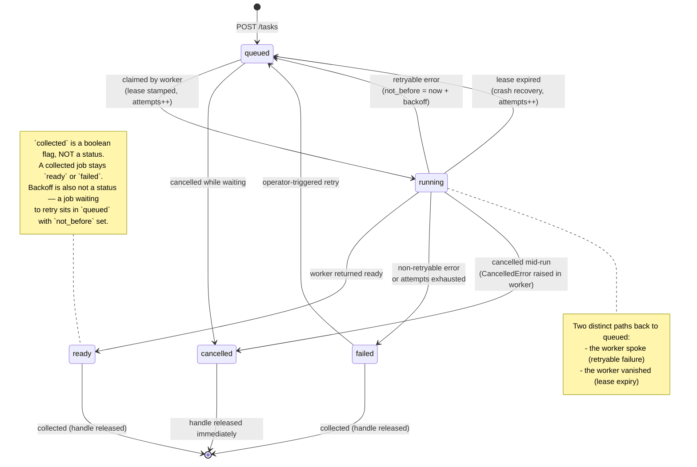
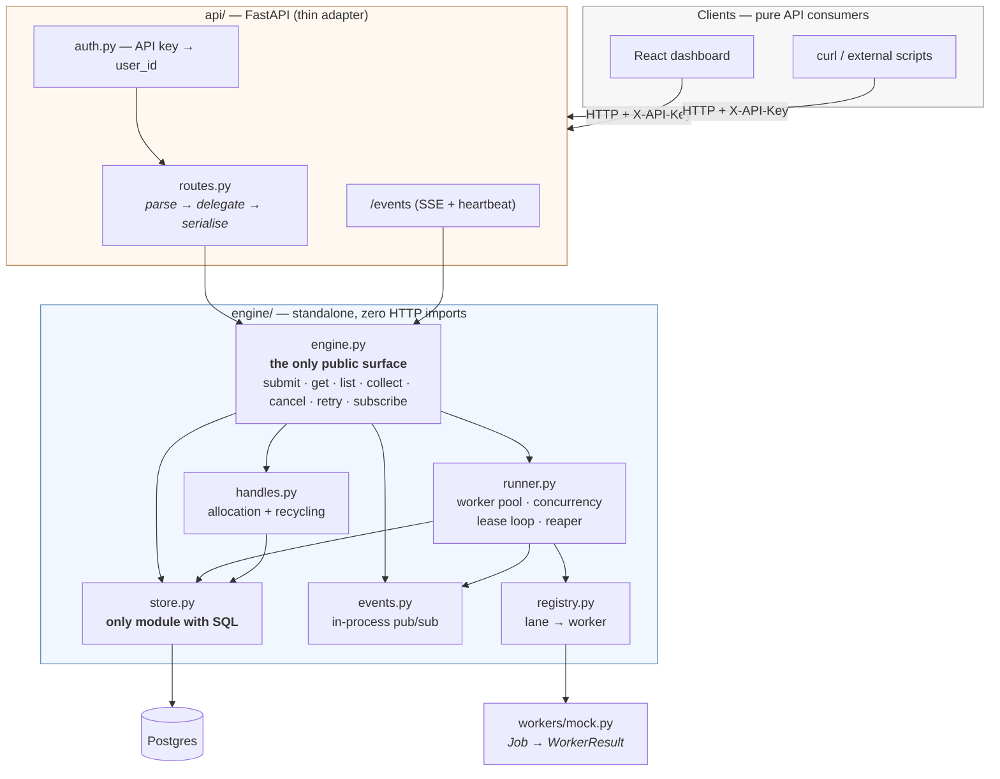
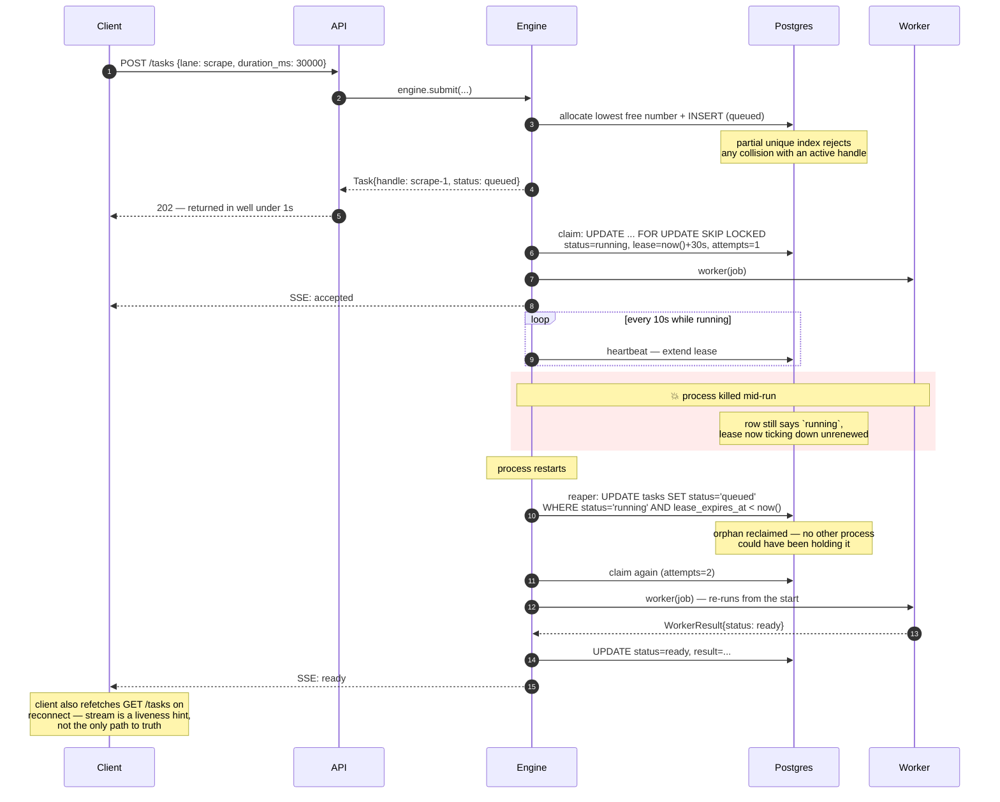

# Background Job Runner

## Overview

## Architecture

### 1. Job lifecycle

The five statuses are fixed by the API contract. Every transition below is one the engine actually performs.



### 2. Module boundaries

The two rules this diagram encodes: nothing under `engine/` imports a web framework, and nothing outside `store.py` touches the database.



**Verifiable in seconds:** `grep -r "fastapi" engine/` returns nothing. `grep -rl "asyncpg" engine/` returns exactly one file.

### 3. Durability — crash and recovery

This is the "sketch your approach" the brief asks for in the durability section.



The reaper runs on boot **and** on a timer — boot-only recovery would miss a worker that hung rather than died.

## Setup & Running Locally

### Database schema

`sql/schema.sql` is the single source of truth for the database, applied by
hand — there's no migration tooling and no `docker-entrypoint-initdb.d` init
script wired into `docker-compose.yml` (see DECISIONS.md, "Raw SQL via
asyncpg rather than an ORM": migrations were a deliberate non-goal for this
proof of concept). After `docker compose up -d`, apply it once:

```
docker compose exec postgres psql -U jobrunner -d jobrunner -f - < sql/schema.sql
```

**If you already have a running database from before `tasks.seq` was added**
(the monotonic ordering column — see DECISIONS.md, "Handle resolution
ordering uses a monotonic sequence, not a timestamp"), a fresh `schema.sql`
apply won't retroactively add it to an existing table. Run the one statement
by hand instead:

```
docker compose exec postgres psql -U jobrunner -d jobrunner -c "ALTER TABLE tasks ADD COLUMN seq BIGSERIAL;"
```

Same end state either way — a fresh clone gets `seq` from `schema.sql`
directly; an existing database gets there via this one `ALTER TABLE`. Worth
keeping in mind if `schema.sql` picks up further changes later: without
migration tooling, every existing database needs its own hand-applied catch-up
statement, not just new ones.

### Seed data

`scripts/seed.py` creates two named demo users and a realistic spread of
tasks across every status, so the dashboard's filtering, sorting, and detail
views have something meaningful to show without needing to manually drive
jobs through the API first. Run it once the schema is applied and the API's
dependencies are installed:

```
python -m scripts.seed
```

This creates:

- **Two users** — `Alice` (`X-API-Key: alice-demo-key`) and `Bob`
  (`X-API-Key: bob-demo-key`). Any other user already in the `users` table
  (leftover ad-hoc keys from manual testing) is removed, except the pytest
  fixture users tests/conftest.py and tests/test_restart.py provision —
  those are left alone so the test suite keeps working against the same
  database.
- **~28 tasks for Alice, ~7 for Bob** — every status represented
  (`queued`, `running`, `ready`, `failed`, `cancelled`), both lanes
  (`scrape`, `report`), a mix of collected/uncollected terminal tasks, and
  `created_at` spread across the last two weeks so date-range filtering has
  something to filter. Every failed row has a distinct, honest reason
  (some exhausted-retry wording, some permanent), and every task has a
  plausible `task_events` history backing its detail view.
- Every seeded row has `seeded: true` (visible on `GET /tasks/{handle}`,
  never on the core `GET /tasks` list shape) so it's never mistaken for
  real activity.

Rows are inserted directly via SQL, not through `engine.submit()` — a
seeded `queued` row would otherwise get claimed and actually "run" the
moment the app starts. The couple of seeded `queued` rows carry a
`not_before` decades in the future for the same reason, and the one seeded
`running` row carries a `lease_expires_at` decades in the future so the
reaper doesn't reclaim it on boot.

Flags:

```
python -m scripts.seed --reset   # delete existing seeded rows first, then reseed
python -m scripts.seed --wipe    # delete ALL rows (tasks + users), asks for confirmation
```

### Known issues

**Docker Desktop + WSL2: pulls fail with truncated layers.** Docker Desktop's containerd image store mishandles range-requested downloads over WSL2, causing `httpReadSeeker: failed open ... EOF` mid-pull. Affects both Windows 10 and 11. Fix: in Docker Desktop, **Settings → General**, disable **"Use containerd for pulling and storing images"**, then Apply & Restart.

## API Reference

## Testing

## Deployment

## Decisions & Tradeoffs

See `DECISIONS.md` for the full log of forks resolved during the build, with options considered and why.

## Demo

## What I'd Do Next
